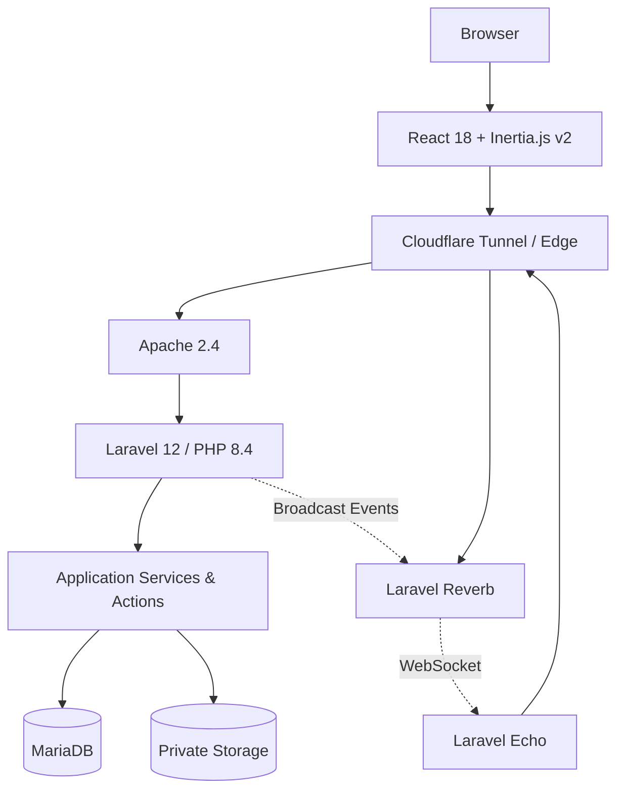

# Sentinel Admission System

> Sistem Informasi Penerimaan Peserta Didik / Santri Baru (SPMB) berbasis web yang dirancang untuk mendigitalisasi seluruh proses penerimaan secara terintegrasi — mulai dari informasi gelombang pendaftaran, registrasi calon peserta, verifikasi dokumen, pembayaran, ujian CBT, hingga dashboard administrasi dengan pembaruan data secara real-time.

Dibangun menggunakan **Laravel 12**, **React 18**, **Inertia.js v2**, **TypeScript**, **Tailwind CSS**, **MariaDB**, dan **Laravel Reverb**.

---

## Gambaran Umum

**Sentinel Admission System** merupakan aplikasi web full-stack yang dikembangkan untuk menangani proses SPMB secara terintegrasi.

Sistem ini dirancang untuk mengurangi ketergantungan terhadap proses manual dalam pengelolaan pendaftaran, verifikasi dokumen, pembayaran, ujian, serta pemantauan status calon peserta.

Alur penerimaan dapat dikelola dalam satu platform:

* **Calon peserta & orang tua** dapat melihat informasi gelombang, melakukan pendaftaran bertahap, mengunggah dokumen, melakukan pembayaran, dan mengikuti ujian CBT.
* **Staff penerimaan** dapat melakukan pemeriksaan dokumen, memverifikasi calon peserta, serta mengelola proses penerimaan.
* **Administrator** dapat mengelola gelombang pendaftaran, memantau statistik, mengelola status calon peserta, dan menghasilkan laporan.

Project ini dikembangkan sebagai **portfolio dan engineering showcase**, dengan fokus pada pengembangan aplikasi yang memiliki workflow bisnis nyata, pengelolaan data yang terstruktur, validasi keamanan file, serta komunikasi real-time.

---

# Fitur Utama

## 📋 Manajemen Pendaftaran & Gelombang

* Pengelolaan gelombang pendaftaran dengan waktu pembukaan dan penutupan.
* Pembatasan kuota berdasarkan kapasitas gelombang.
* Penutupan otomatis ketika kuota telah terpenuhi.
* Pengaturan program/jurusan dan persyaratan dokumen.
* Pengaturan biaya pendaftaran berdasarkan program.
* Informasi ketersediaan kuota yang diperbarui secara real-time.

---

## 👤 Registrasi & Siklus Calon Peserta

* Formulir pendaftaran multi-langkah.
* Penyimpanan draft pendaftaran secara bertahap.
* Calon peserta dapat melanjutkan pendaftaran yang belum selesai.
* Perlindungan kepemilikan draft menggunakan `draft_token`.
* Pengelolaan status calon peserta melalui service khusus.

Siklus status utama:

```text
draft
  ↓
submitted
  ↓
verified
  ↓
paid
  ↓
accepted / rejected
```

Pengelolaan transisi status dipusatkan melalui `StatusPendaftaranService` untuk menjaga konsistensi proses bisnis.

---

# 📄 Verifikasi & Keamanan Dokumen

Dokumen calon peserta diproses melalui beberapa lapisan validasi sebelum disimpan.

### Validasi Format

Sistem tidak hanya bergantung pada ekstensi file yang dikirim oleh browser, tetapi juga melakukan pemeriksaan terhadap signature/binary header file.

Contoh signature yang diperiksa:

```text
JPEG → FF D8 FF
PNG  → 89 50 4E 47
PDF  → %PDF
```

### Pemeriksaan Payload Mencurigakan

File juga diperiksa terhadap pola tertentu yang dapat mengindikasikan payload berbahaya atau file polyglot, termasuk pola seperti:

```text
<?php
eval(
system(
base64_decode(
```

### Private Storage

Dokumen sensitif tidak disimpan sebagai file publik.

File ditempatkan pada:

```text
storage/app/private/
```

Akses terhadap dokumen dilakukan melalui mekanisme aplikasi yang memverifikasi hak akses sebelum file diberikan kepada pengguna.

> Dokumentasi arsitektur & pipeline lengkap: [File Upload Security Pipeline](docs/architecture/security-and-uploads.md).

---

# 📝 Ujian Online / CBT

Sentinel memiliki modul ujian berbasis web untuk mendukung proses Computer-Based Test (CBT).

Fitur utama:

* Ujian untuk calon peserta terdaftar.
* Dukungan guest exam dengan access token.
* Session token untuk membatasi akses ujian.
* Timer ujian.
* Auto-submission ketika waktu berakhir.
* Penyimpanan jawaban selama ujian.
* Import bank soal melalui file XLSX.
* Pemrosesan spreadsheet menggunakan OpenSpout untuk penggunaan memori yang lebih efisien.

---

# 💳 Pembayaran

Sistem memiliki integrasi pembayaran menggunakan **Midtrans Snap**.

Dukungan mencakup:

* Virtual Account.
* QRIS.
* E-wallet.
* Webhook notification.
* Verifikasi signature webhook.
* Sinkronisasi status pembayaran dengan status pendaftaran.
* Pembayaran manual melalui upload bukti transfer sebagai alternatif.

Alur pembayaran secara umum:

```text
Pendaftaran
    ↓
Invoice / Payment
    ↓
Midtrans
    ↓
Webhook
    ↓
Verifikasi Signature
    ↓
Update Status Pembayaran
```

Credential Midtrans tidak disimpan di repository dan dikonfigurasi melalui environment variable.

---

# 📊 Dashboard & Real-time Monitoring

Dashboard administrasi menggunakan **Laravel Reverb + Laravel Echo** untuk pembaruan data secara real-time.

Contohnya:

* perubahan kuota gelombang;
* perubahan status calon peserta;
* pembaruan metrik dashboard;
* perubahan statistik penerimaan.

Administrator tidak perlu melakukan refresh halaman secara manual untuk mendapatkan perubahan tertentu.

### Simulasi Traffic

Project juga memiliki command untuk mensimulasikan aktivitas calon peserta:

```bash
php artisan demo:simulate-traffic --count=20 --mode=stream --delay=1.0
```

Data simulasi dapat dibersihkan menggunakan:

```bash
php artisan demo:wipe
```

Command tersebut membantu pengujian fitur real-time sekaligus demonstrasi kemampuan dashboard.

> Panduan lengkap opsi simulasi & benchmark: [Panduan Traffic Simulator](docs/operations/traffic-simulator.md).

---

# 🏗️ Arsitektur Sistem



### Komponen Utama

**Frontend**

React + Inertia menangani antarmuka aplikasi dan komunikasi dengan backend Laravel.

**Backend**

Laravel menangani routing, authentication, business logic, database interaction, validation, payment processing, serta application services.

**Realtime**

Laravel Reverb menyediakan WebSocket server, sedangkan Laravel Echo digunakan oleh frontend untuk menerima event secara real-time.

**Database**

MariaDB digunakan sebagai persistence layer untuk data pendaftaran, program, gelombang, calon peserta, ujian, pembayaran, dan data sistem lainnya.

**Private Storage**

Dokumen calon peserta disimpan pada private filesystem dan tidak diekspos secara langsung sebagai static public asset.

---

# 🧰 Tech Stack

| Layer              | Teknologi                |
| ------------------ | ------------------------ |
| Backend            | Laravel 12               |
| Runtime            | PHP 8.4                  |
| Frontend           | React 18                 |
| SPA / Routing      | Inertia.js v2            |
| Language           | TypeScript               |
| Styling            | Tailwind CSS             |
| Database           | MariaDB                  |
| Realtime           | Laravel Reverb           |
| WebSocket Client   | Laravel Echo + Pusher JS |
| Web Server         | Apache 2.4               |
| Payment            | Midtrans Snap            |
| Spreadsheet        | OpenSpout                |
| Calendar           | FullCalendar             |
| Charts             | Recharts                 |
| Alert / Modal      | SweetAlert2              |
| Testing            | Pest PHP                 |
| Containerization   | Docker + Docker Compose  |
| Public Demo Tunnel | Cloudflare Tunnel        |

> Spesifikasi teknis & seluruh dependensi: [Tech Stack & Dependencies](docs/reference/tech-stack.md).

---

# ⚙️ Engineering Highlights

Project ini tidak hanya berfokus pada tampilan aplikasi, tetapi juga pada struktur dan reliability di sisi backend.

### Pemisahan Business Logic

Controller digunakan sebagai orchestration layer, sementara proses bisnis yang lebih kompleks ditempatkan pada service dan action khusus.

Contoh:

```text
app/
├── Actions/
├── Services/
├── Http/
│   ├── Controllers/
│   └── Requests/
└── Models/
```

Beberapa bagian penting antara lain:

* `StatusPendaftaranService`
* `PaymentService`
* `SecureFileAccessService`
* `SubmitExamAttempt`
* `SaveExamAnswer`

---

### Pemrosesan Spreadsheet

OpenSpout digunakan untuk menangani proses import/export XLSX dengan pendekatan streaming sehingga tidak perlu memuat keseluruhan workbook ke memory PHP sekaligus.

Hal ini digunakan terutama pada:

* import bank soal;
* proses data kandidat;
* kebutuhan export/reporting.

---

### Pipeline Validasi Dokumen

Upload dokumen melewati beberapa tahapan sebelum disimpan:

```text
Upload
  ↓
MIME Validation
  ↓
Magic-Byte Validation
  ↓
Suspicious Payload Detection
  ↓
UUID Filename
  ↓
Private Storage
```

Pendekatan ini memberikan lapisan validasi tambahan di luar pemeriksaan ekstensi file.

---

### Resilient Real-time Broadcasting

Fitur real-time dirancang agar kegagalan koneksi WebSocket tidak menyebabkan proses bisnis utama ikut gagal.

Dengan demikian, operasi administratif tetap dapat berjalan ketika Reverb sedang tidak tersedia.

---

# 🔐 Keamanan

Beberapa mekanisme keamanan yang diterapkan dalam aplikasi meliputi:

### Authentication & Authorization

Akses dibedakan berdasarkan peran pengguna seperti:

* Administrator
* Staff
* Candidate

Route dan controller menggunakan mekanisme authorization untuk membatasi akses sesuai peran.

### Candidate Data Ownership

Operasi terhadap data calon peserta melakukan pemeriksaan kepemilikan sehingga ID calon peserta tidak dapat digunakan secara bebas untuk mengakses data milik peserta lain.

### Draft Token

Pendaftaran yang belum selesai menggunakan token kepemilikan yang disimpan melalui HttpOnly cookie untuk membantu mencegah akses tidak sah terhadap draft pendaftaran.

### File Security

Dokumen diperiksa menggunakan:

* MIME validation;
* magic-byte inspection;
* suspicious payload detection;
* private filesystem;
* controller-gated access.

### Environment Secrets

Credential seperti:

* `APP_KEY`
* Midtrans Server Key
* Resend API Key
* database password
* Reverb App Secret

tidak disimpan langsung di source code dan menggunakan environment configuration.

---

# 🔄 Arsitektur Real-time

Komunikasi real-time menggunakan Laravel Reverb dan Laravel Echo.

Secara sederhana:

```text
Perubahan Data
      │
      ▼
Laravel Event
      │
      ▼
Laravel Reverb
      │
      ▼
WebSocket
      │
      ▼
Laravel Echo
      │
      ▼
React UI
```

Beberapa event yang digunakan antara lain:

* `DashboardMetricsUpdated`
* `WaveUpdated`

Contoh penggunaan:

```text
Perubahan kuota gelombang
        ↓
WaveUpdated
        ↓
Reverb
        ↓
Public Landing Page
        ↓
Kuota diperbarui tanpa refresh
```

Sementara dashboard administrasi menerima event perubahan metrik untuk memperbarui informasi secara langsung.

---

# 🐳 Docker

Project menggunakan Docker untuk menyediakan runtime aplikasi PHP/Apache dan server Laravel Reverb.

Komponen utama:

```text
Docker Compose
├── app
│   └── PHP 8.4 + Apache
│
└── reverb
    └── Laravel Reverb
```

Project saat ini menggunakan **bind mount** untuk source code sehingga perubahan file selama development dapat langsung digunakan oleh container.

Database MariaDB pada workflow saat ini dijalankan sebagai service terpisah dari container aplikasi.

> Konfigurasi Docker pada repository ini ditujukan terutama untuk workflow development/demo, bukan sebagai image distribution siap produksi.

---

# 🚀 Menjalankan Secara Lokal

## Prasyarat

Untuk workflow lokal, siapkan:

* Docker & Docker Compose
* PHP 8.4+
* Composer 2.x
* Node.js 20+
* npm
* MariaDB 10.11+ / 11.x

> Panduan instalasi langkah demi langkah: [Local Development Setup Guide](docs/getting-started/local-development.md).

---

## 1. Clone Repository

```bash
git clone https://github.com/your-username/sentinel-admission.git
cd sentinel-admission
```

Ganti URL repository dengan URL repository aktual.

---

## 2. Konfigurasi Environment

```bash
cp .env.example .env
```

Kemudian sesuaikan konfigurasi database:

```env
DB_HOST=
DB_PORT=
DB_DATABASE=
DB_USERNAME=
DB_PASSWORD=
```

Credential untuk service eksternal seperti Midtrans, mail provider, dan Reverb diisi sesuai kebutuhan.

---

## 3. Install Dependency

```bash
composer install
npm install
```

---

## 4. Generate Application Key

```bash
php artisan key:generate
```

---

## 5. Migrasi & Seeder

```bash
php artisan migrate --seed
```

Seeder menyediakan data awal untuk kebutuhan development dan testing.

---

## 6. Build Frontend

```bash
npm run build
```

Untuk development dengan Vite:

```bash
npm run dev
```

---

## 7. Jalankan Docker

```bash
docker compose up -d
```

Aplikasi dapat diakses melalui:

```text
http://localhost:8080
```

Laravel Reverb:

```text
ws://localhost:8085
```

---

# 👤 Akun Demo / Testing

Seeder menyediakan akun dummy untuk kebutuhan development.

| Role  | Email            | Password   |
| ----- | ---------------- | ---------- |
| Admin | `admin@spmb.com` | `password` |
| Staff | `staff@spmb.com` | `password` |

> Credential di atas ditujukan untuk development/testing. Jangan menggunakan credential default ketika instance diekspos ke jaringan publik.

> Rujukan kredensial dan skrip testing: [Demo Accounts & Testing Guide](docs/getting-started/demo-testing.md).

---

# 🧪 Testing

Project menggunakan **Pest PHP** untuk automated testing.

Menjalankan test:

```bash
php artisan test
```

Area yang tercakup antara lain:

* workflow candidate;
* authorization;
* validasi keamanan dokumen;
* integritas draft token;
* CBT exam session;
* submission ujian;
* validasi signature Midtrans webhook;
* sinkronisasi status pembayaran.

---

# 📁 Struktur Project

```text
sentinel-admission/
├── app/
│   ├── Actions/
│   ├── Console/Commands/
│   ├── Events/
│   ├── Http/Controllers/
│   ├── Models/
│   └── Services/
│
├── database/
│   ├── migrations/
│   ├── factories/
│   └── seeders/
│
├── resources/
│   ├── js/
│   │   ├── Components/
│   │   ├── Pages/
│   │   │   ├── Admission/
│   │   │   ├── Dashboard/
│   │   │   ├── Landing/
│   │   │   └── Public/Exam/
│   │   └── echo.ts
│   └── views/
│
├── routes/
│   ├── web.php
│   ├── api.php
│   └── exam.php
│
├── tests/
├── docs/
│   ├── README.md               # Indeks utama dokumentasi sistem
│   ├── getting-started/        # Panduan instalasi lokal & testing
│   ├── architecture/           # Desain sistem, keamanan, frontend/backend
│   ├── operations/             # Traffic simulator, Docker, rollback
│   ├── state-aktif/            # Status aktif auditor AI
│   ├── audit/                  # Runbook, release gates, manifest & evidence
│   └── reference/              # Skema DB, daftar route, tech stack
├── Dockerfile
├── docker-compose.yml
├── composer.json
└── package.json
```

---

# 🌐 Live Demo

Demo publik tersedia di:

**https://spmb.playground-ku.my.id**

> Demo dapat mengalami downtime atau maintenance sewaktu-waktu.

---

# 📸 Screenshots

Screenshot antarmuka akan ditambahkan sebagai bagian dari dokumentasi portfolio.

Beberapa tampilan yang direncanakan:

* Landing Page SPMB
* Formulir Pendaftaran
* Dashboard Administrator
* Verifikasi Dokumen
* Ujian CBT
* Dashboard real-time

---

# 📌 Status Project

**Sentinel Admission System** dikembangkan sebagai **portfolio dan engineering showcase** untuk mendemonstrasikan pengembangan aplikasi SPMB full-stack dengan workflow bisnis yang kompleks.

Fokus pengembangan meliputi:

* pengelolaan proses pendaftaran;
* keamanan dan validasi dokumen;
* integrasi pembayaran;
* ujian CBT;
* dashboard administrasi;
* komunikasi real-time;
* automated testing;
* serta containerized development workflow.

---

# 📄 Lisensi

Repository ini merupakan **portfolio pribadi** dan tidak dimaksudkan sebagai proyek open-source yang memberikan hak penggunaan, modifikasi, atau redistribusi secara bebas.

**All Rights Reserved.**
