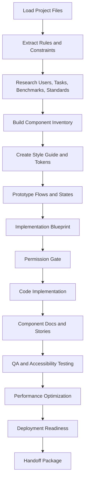
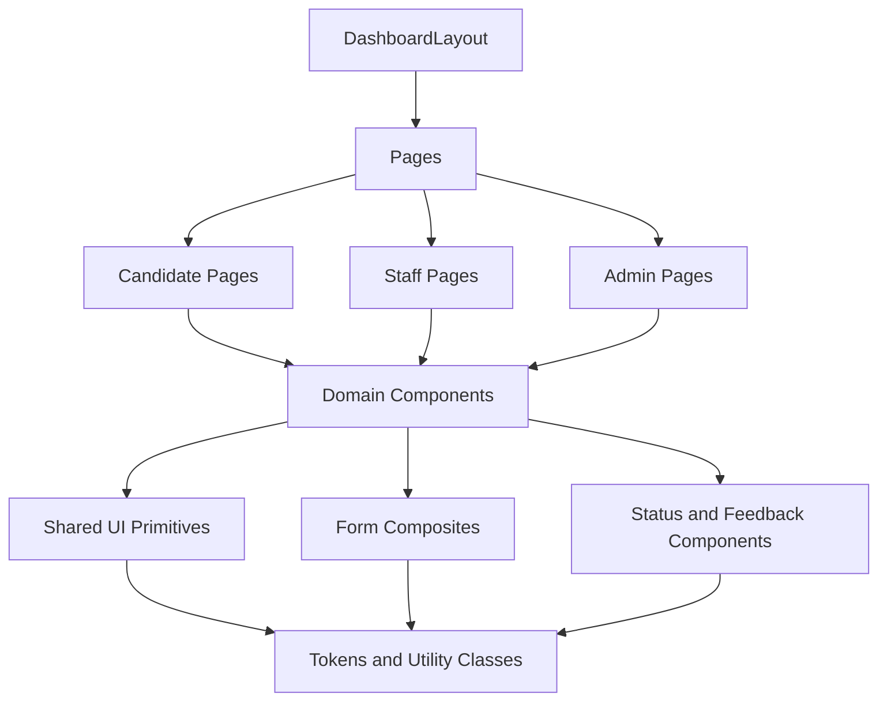

# AI Documentation for Production Frontend Research and Premium Design Delivery

## Executive Summary

This document is a production-oriented playbook for training an AI to research, design, implement, validate, and hand off premium-class frontend web interfaces. It is designed to work in two modes at once: as a Markdown operating manual for the AI, and as working notes for a human designer or frontend lead. It assumes that the two uploaded Markdown files are authoritative project-context inputs and should be loaded before any design work begins. In the current project, those files establish a Laravel 12 + Inertia.js v2 + React + TypeScript + Tailwind CSS stack, a modern-monolith architecture, thin page orchestrators, domain-driven component folders, Fish shell workflows, mobile-first constraints, hardcoded dark-mode class requirements, and an explicit permission gate before code execution. fileciteturn0file0 fileciteturn0file1

The most important strategic recommendation is to **default to the existing stack and architecture unless the research phase proves a compelling reason to switch**. For this repository, that means optimizing for Laravel + Inertia + React rather than introducing a second frontend repository or forcing a framework migration. Laravel’s frontend guidance explicitly positions Inertia as a bridge that lets teams build React, Svelte, or Vue frontends while keeping routing, hydration, and authentication in one repository, and the Inertia docs describe this as building SPA-like experiences with server-side routing and no separate API requirement. citeturn24view2turn23view0

For production quality, the AI should treat frontend work as a pipeline rather than as “prompt-to-code.” The preferred pipeline is: ingest project context, research comparable interfaces and UX patterns, derive information architecture and component hierarchy, produce a style guide and prototype, implement against a stable component system, run accessibility and functional QA, optimize performance, then create a handoff package. That sequence aligns with React’s recommended practice of breaking a mockup into a component hierarchy and building a static version before interactivity, and it aligns with the project’s own required workflow of discussion, strategy, blueprint, audit, confirmation, permission gate, and clean execution. citeturn25view0turn0file0

The recommended tooling stack for a premium frontend workflow is straightforward and mostly official: Tailwind CSS for utility-first styling and responsive work, Storybook for component development and documentation, Storybook’s accessibility addon plus axe-core-backed checks for automated a11y testing, Vitest for unit and component tests, Playwright for end-to-end and cross-browser coverage, Lighthouse for performance, accessibility, SEO, and regression monitoring, and Figma Dev Mode for design handoff and structured design context when design files exist. Radix Primitives or Headless UI are the strongest default choices for accessible, unstyled building blocks in a custom design system. citeturn8view0turn9view0turn28view0turn16view1turn17view2turn29view0turn27view1turn22view0turn22view1

A bilingual sourcing policy is practical here. The primary sources for framework, tooling, and standards remain the English official docs, but web.dev and W3C WAI resources both surface Indonesian availability, which makes them useful for human onboarding and stakeholder documentation in mixed-language teams. citeturn13view0turn15view1

## Project Assumptions and Input Model

### Assumptions

The following assumptions are used throughout this report:

| Assumption | Why it is reasonable | Practical effect |
|---|---|---|
| The two uploaded `.md` files are the authoritative context inputs for this task. | They were provided specifically as project files and contain stable rules, architecture, routes, environment details, and design constraints. fileciteturn0file0 fileciteturn0file1 | The AI must ingest them before generating design decisions, implementation plans, or prompts. |
| The uploaded files are context/reference files, not the full source tree. | They describe architecture, workflows, routes, and structure, but they are not executable code. fileciteturn0file1 | The AI should produce hypotheses and implementation notes, and request actual source files only when code-level dependency is unavoidable. |
| The default delivery target is the current Laravel + Inertia + React + Tailwind app, not a greenfield rewrite. | The project file defines that stack and the current folder and route structure. fileciteturn0file1 | Recommendations should optimize the existing architecture first, then list alternatives separately. |
| “Premium-class” refers to polish, systems thinking, accessibility, performance discipline, and production readiness. | This report operationalizes that term into measurable design, engineering, and QA behaviors. | The AI must not optimize for visual novelty alone. |

### How the AI should use the two project files

The AI should interpret the two uploaded files as two distinct layers of context.

The first file is an **operating-system file**. It defines persona, collaboration style, non-negotiable workflow gates, approval rules, architectural guardrails, shell constraints, security posture, mobile-first rules, and frontend implementation caveats like hardcoded dark-mode classes and theme handling. That file is not decoration; it changes the order in which the AI must work. In particular, it says not to start coding without explicit approval, to follow a discussion → strategy → blueprint → audit → confirmation → permission → execution flow, and to respect mobile-first constraints and Fish shell syntax. fileciteturn0file0

The second file is a **project architecture reference**. It defines the brand, tech stack, color system, route truth, controllers, frontend folder structure, menu policies, current feature status, and environment/deployment details such as Docker, Cloudflare Tunnel, and Fish aliases. It also clarifies that the app is a digital admissions system, that page components should remain thin orchestrators, and that candidate/staff/admin areas already follow a domain-oriented folder structure. fileciteturn0file1

The AI should therefore build an internal context object before beginning design research. A simple pattern is:

```yaml
project_context:
  source_files:
    - 00_core(2).md
    - 01_project.final(2).md
  operating_rules:
    approval_required_before_code: true
    workflow_gate: [discussion, strategy, blueprint, audit, confirmation, permission, execution]
    shell: fish
    mobile_first: true
    touch_target_min: "44x44"
    input_font_min: "16px"
    dark_mode_classes: "hardcoded only"
  architecture:
    backend: "Laravel 12"
    bridge: "Inertia.js v2"
    frontend: "React + TypeScript"
    styling: "Tailwind CSS"
    layout_rule: "pages are thin orchestrators"
  project_goal:
    product: "Digital school admission system"
    ui_tone: "premium, trustworthy, accessible, efficient"
  library_constraints:
    preserve:
      - animejs
      - react-select
      - sweetalert2
      - flatpickr
```

That object should be created once per session, refreshed whenever new files are uploaded, and referenced by every subsequent prompt or reasoning step. The point is to stop the AI from acting like the repo is generic when it is not. This is especially important because project rules such as “never use `npm run dev` in demo-mode,” “ask branch before schema changes or new features,” and “generate full replacement files rather than partials” directly affect development workflow and handoff quality. fileciteturn0file0 fileciteturn0file1

### Source policy for this documentation

Use official documentation and primary sources first. For this report, that means React, Laravel, Inertia, Tailwind, W3C WAI/WCAG, Chrome/web.dev, Storybook, Playwright, Vitest, framework docs, and official product docs such as Figma Dev Mode. For bilingual support, use Indonesian translations or language options when available, especially for accessibility and performance guidance aimed at human collaborators. W3C WAI tutorials explicitly list Bahasa Indonesia as a translation, and web.dev surfaces an Indonesia locale in its UI and resource pages. citeturn15view1turn13view0

## Objectives, Scope, and Deliverables

### Objectives

The AI’s job is not simply to “make the UI pretty.” Its objectives are broader and stricter:

1. Research the problem space, user tasks, visual references, regulatory/accessibility constraints, and current project limitations.
2. Convert that research into a componentized, token-driven frontend design system.
3. Produce implementation-ready guidance that fits the current stack and repository structure.
4. Validate the result against accessibility, responsiveness, maintainability, and performance targets.
5. Hand off a package that a human designer, frontend engineer, or reviewer can use without reverse-engineering the AI’s intent.

For the current repository, these objectives should be mapped onto the existing dashboard and domain structure rather than treated as a blank slate, because the project already defines candidate, staff, and admin areas; current routes; and current component/layout conventions. fileciteturn0file1

### Scope

The scope of this documentation includes:

- Context ingestion from the two uploaded files.
- UX and UI research.
- Component inventory and information architecture.
- Style-guide creation.
- Prototyping.
- Implementation planning and code patterns.
- Accessibility, responsive, performance, and quality assurance.
- Optimization and deployment readiness.
- Handoff documentation.

The scope does **not** include unapproved database schema changes, silent architecture rewrites, or introducing a parallel repository without justification. Those are explicitly constrained by the uploaded files. fileciteturn0file0 fileciteturn0file1

### Deliverables

| Deliverable | Audience | Minimum content | Done when |
|---|---|---|---|
| Executive research brief | AI + designer + tech lead | goals, context, risks, assumptions, stack choice | everyone can explain why the UI will look and behave the way it does |
| Component inventory | designer + frontend engineer | pages, sections, reusable components, state ownership, dependencies | no major UI element is “improvised” during coding |
| Style guide | designer + engineer | tokens, type scale, spacing, surfaces, motion, dark mode, states | designers and engineers can style new screens consistently |
| Prototype notes | designer + PM + engineer | user flows, interaction states, empty/error/loading states | flows are reviewable before implementation |
| Implementation blueprint | engineer | folders, component boundaries, testing plan, command plan | coding can start without structural ambiguity |
| QA matrix | QA + engineer | devices, browsers, accessibility checks, visual checks, regression tests | release criteria are explicit |
| Optimization report | engineer + product | vitals, bundle changes, Lighthouse, hot spots, trade-offs | there is a measurable before/after |
| Handoff package | designer + engineer + reviewer | Markdown docs, stories, test results, screenshots, unresolved decisions | the next person can continue without re-discovery |

These deliverables are derived from the way React encourages decomposition into component hierarchies, the way Storybook supports documentation/testing across components, and the way Lighthouse, Playwright, and accessibility tooling operationalize quality gates. citeturn25view0turn28view0turn29view0turn16view1turn17view2

## Skill Model and Technology Decisions

### Required skills and knowledge

The AI should be trained to reason across the following disciplines, not as isolated topics but as connected constraints:

| Area | What the AI must know | Why it matters |
|---|---|---|
| UX research | task flows, benchmark analysis, IA, content hierarchy | prevents visually attractive but task-hostile screens |
| UI design | spacing systems, typography, color, hierarchy, states, motion restraint | creates premium polish and consistency |
| Accessibility | semantic HTML, keyboard flows, ARIA patterns, focus management, WCAG 2.2 AA | reduces legal and usability risk; WAI-ARIA and WCAG are core references. citeturn3view3turn15view0 |
| Responsive design | mobile-first layout, breakpoint strategy, container-awareness, touch ergonomics | Tailwind explicitly recommends a mobile-first approach, and the project files add 44×44 targets and 16px inputs. citeturn9view0turn9view1 fileciteturn0file0 |
| Performance | Core Web Vitals, rendering trade-offs, JS budget discipline, regression tooling | fast UIs are measurable using LCP, INP, and CLS. citeturn14view0turn29view0 |
| Design systems | tokens, reusable components, docs, versioning, component-to-design alignment | premium delivery depends on systems, not isolated screens |
| CSS architecture | utility-first strategy, CSS Modules where needed, theme consistency | Tailwind and Vite provide a practical default architecture. citeturn8view0turn4view1 |
| JavaScript frameworks | React composition and state structure; alternatives when the problem changes | framework choice should fit repository structure and rendering needs. citeturn25view0turn26view0turn24view2 |
| Build tools | Vite, framework builders, asset pipelines | affects DX, bundles, and deployment behavior. citeturn24view3turn4view0turn4view3 |
| Testing | unit, component, accessibility, E2E, visual, CI gates | required for production confidence. citeturn17view3turn17view1turn16view1turn29view0 |
| Deployment | static vs SSR vs self-hosted monolith trade-offs, cache and versioning concerns | prevents last-mile production failures. citeturn7view1turn7view2turn24view2 |

### Recommended default stack for this repository

For the uploaded project, the default stack should remain:

- **Backend/application shell:** Laravel 12.
- **Frontend bridge:** Inertia.js v2.
- **Frontend runtime:** React + TypeScript.
- **Styling:** Tailwind CSS with class-based dark mode.
- **Existing UI/tooling ecosystem:** Anime.js, Recharts, SweetAlert2, react-select, flatpickr, Font Awesome, Ziggy, Axios.
- **Deployment/runtime environment:** Docker + Cloudflare Tunnel, Fish shell aliases, demo/dev mode separation. fileciteturn0file1

That recommendation is not just conservative. It is structurally justified. Laravel explicitly recommends Inertia starter kits for React/Svelte/Vue when teams want modern frontend experiences without splitting routing, hydration, and authentication into separate repositories, and Inertia itself is designed around frontend experiences built with a backend you keep in place. citeturn24view2turn24view1turn23view0

### Framework comparison

| Option | Best use case | Strengths | Trade-offs | Recommendation basis |
|---|---|---|---|---|
| **Laravel + Inertia + React** | Existing monolith apps with strong backend ownership | Keeps routing/controllers/auth in one repo; React component model is mature; no separate API is required. | Less opinionated than Next.js for SSR/RSC-style React-specific patterns. | Best fit for this repo. citeturn24view2turn23view0 fileciteturn0file1 |
| **React + Vite** | Greenfield SPA/component-heavy apps | Vite supports TS, JSX, CSS Modules, and fast builds by default. React docs strongly support component decomposition and state discipline. | You must define routing, SSR, deployment, and app architecture yourself. | Good for isolated UI packages or prototypes. citeturn4view0turn4view1turn4view3turn25view0turn26view0 |
| **Next.js** | React apps needing full framework features, file conventions, server/client boundary tools, and deeper deployment guidance | Project structure conventions, App Router features, self-hosting guidance, cache and deployment controls. | More infrastructure and rendering-model choices to manage. | Strong alternative for future greenfield products, not a drop-in replacement here. citeturn6view0turn7view1turn7view2 |
| **Vue 3** | Teams that prefer declarative templates and SFCs | Progressive, incrementally adoptable, SFC-first workflow, strong reactivity model. | Would require team/repo migration from the current React architecture. | Good if the team deliberately standardizes around Vue later. citeturn18view0 |
| **Svelte / SvelteKit** | Teams prioritizing lean compiled output and reduced runtime overhead | Svelte compiles declarative components into tightly optimized JavaScript. | Different mental model and ecosystem from the current repo. | Useful for future experiments, not the default here. citeturn20view0 |
| **Astro** | Content-heavy websites, marketing, docs, SEO-first landing pages | Server-first, “zero JS by default,” content-oriented architecture, reduced JS overhead. | Less natural as the primary shell for dashboard-heavy application UX. | Ideal for public-facing microsites or docs, not the main admissions dashboard. citeturn19view2turn19view3 |

### Tool and library comparison

| Category | Default recommendation | Why | Primary source |
|---|---|---|---|
| Styling system | Tailwind CSS | Utility-first workflow, responsive design, dark mode support, zero-runtime generated CSS. | citeturn8view0turn9view0turn9view2 |
| Build tool | Vite | TS/JSX support, CSS Modules support, glob imports, fast dev/build workflow. | citeturn4view0turn4view1turn4view2turn4view3 |
| Component workshop | Storybook | Installable in one command; supports docs, testing, and a11y features in the recommended setup. | citeturn28view0 |
| Accessibility checks | Storybook a11y addon + axe-core | Automated DOM audits and configurable rulesets; integrates with Storybook/Vitest. | citeturn16view1 |
| Unit/component testing | Vitest | “Next generation testing framework powered by Vite.” | citeturn17view3 |
| E2E and browser coverage | Playwright | Supports Chromium, WebKit, and Firefox across Windows, Linux, and macOS, locally or in CI. | citeturn17view1 |
| Performance auditing | Lighthouse + Lighthouse CI | Open-source automated audits for performance, accessibility, SEO, and more; CLI and CI ready. | citeturn29view0turn29view2 |
| Accessible primitives | Radix Primitives | High-quality, accessible, unstyled primitives aligned with WAI-ARIA patterns. | citeturn22view0 |
| Accessible unstyled components | Headless UI | Completely unstyled, fully accessible components designed to integrate well with Tailwind. | citeturn22view1 |
| Design handoff | Figma Dev Mode | Connects design and code components, structured inspection, dev resources, and design-informed AI/code workflows. | citeturn27view1 |

### CSS architecture recommendation

For this project, the cleanest CSS architecture is:

- **Tailwind utility classes as the primary styling layer**.
- **Design tokens** for color, spacing, typography, radii, elevation, motion, and semantic states.
- **Small CSS Modules** only for cases where utility composition becomes unreadable or where advanced selectors/layout logic are more maintainable in CSS.
- **Hardcoded dark-mode classes** in the current repo, because the uploaded operating rules explicitly forbid dynamic dark-mode class string construction. citeturn8view0turn9view0turn9view2turn4view1 fileciteturn0file0

## End-to-End AI Workflow

### Workflow diagram



This workflow intentionally combines the project’s mandatory approval process with React’s “break the UI into components first” methodology and the modern component-doc/testing pipeline supported by Storybook, Playwright, Vitest, and Lighthouse. fileciteturn0file0 citeturn25view0turn28view0turn17view1turn17view3turn29view0

### Step-by-step operating procedure

#### Research

Begin with context ingestion. Parse both uploaded files into hard constraints, architecture facts, design-system facts, environment facts, and workflow gates. Then research the target user flows and benchmark references. For an admissions system, that typically means public landing flows, registration/wizard flows, dashboard summaries, profile data forms, document uploads, status communication, and staff/admin review flows. The research output should be a concise problem framing memo with assumptions, reference patterns, and risks. The benchmark review should look for hierarchy, conversion clarity, data density, accessibility, and dark-mode behavior, not cosmetic resemblance alone. The project already defines public, candidate, staff, and admin regions, plus current routes and future/ComingSoon conventions, so the research must respect those information boundaries. fileciteturn0file1

#### Component inventory

Use React’s “Thinking in React” approach: start from mockups or route surfaces, draw boxes around components and subcomponents, and derive a hierarchy. React explicitly recommends breaking the UI into components, building the static version first, and keeping data flowing one way through the hierarchy. The current project’s architecture strengthens that guidance by stating that pages should stay thin and logic/UI details should live in domain components. citeturn25view0 fileciteturn0file1

A practical inventory for this repo should classify components into:

- shell and layout components,
- page-level screens,
- domain modules,
- shared UI primitives,
- form/input composites,
- feedback/status states,
- chart and data-display components,
- workflow-specific composites such as document upload and payment proof UI.

#### Style guide

After the component inventory, build a style guide from tokens outward. Start with existing project brand and shell/content color tokens, dashboard accent colors, typography rules, spacing scale, border radius scale, elevation rules, focus styles, motion rules, and dark-mode behavior. Tailwind supports responsive and dark-mode strategies directly, while the project files already define brand colors and shell/content token sets. The style guide should also define semantic states such as info, success, warning, error, loading, disabled, skeleton, and pending-review. fileciteturn0file1 citeturn8view0turn9view2

#### Prototyping

Prototype the major flows before implementation. This does not require high-fidelity design for every route, but it does require at least the key states. Each screen should have: default, loading, empty, error, validation-error, success, disabled, and responsive states. If a design file exists, Figma Dev Mode is an effective place to connect design and code components, inspect breakpoints, and preserve structured implementation context. citeturn27view1

#### Implementation blueprint

Before writing code, create a structure plan. Define which folders, component boundaries, stories, tests, and tokens are needed. Specify state ownership carefully. React’s state guidance is especially relevant: avoid contradictions, redundant state, and duplicate state; prefer simpler structures that are easy to update without getting out of sync. citeturn26view0turn26view1turn26view2

#### Permission gate

For this project, do not cross from blueprint to code automatically. The uploaded operating rules explicitly require confirmation and explicit approval before coding begins. In practice, the AI should output a blueprint summary and wait for the execution phrase the project rules expect. fileciteturn0file0

#### Implementation

When implementation starts, use the existing repo structure. Keep pages as orchestrators, move logic into domain components, preserve required libraries, use hardcoded dark classes, and follow Fish-shell/environment rules. If component primitives are needed for accessibility-heavy widgets like dialogs, selects, tabs, tooltips, menus, and switches, prefer Radix or Headless UI over custom widget logic unless there is a strong product-driven reason not to. fileciteturn0file0 fileciteturn0file1 citeturn22view0turn22view1

#### QA

Run QA across four layers: visual consistency, interaction correctness, accessibility, and responsiveness. Storybook a11y runs automated checks based on axe-core. Storybook also supports docs/testing packages in its recommended setup. Playwright covers end-to-end flows and browser engines, and Lighthouse covers performance, accessibility, SEO, and broader page quality. WAI tutorials and WCAG 2.2 remain the rulebook for manual accessibility review, especially for issues automation cannot resolve fully. citeturn16view1turn17view1turn29view0turn3view3turn15view1

#### Optimization

Use performance as a design tool, not a finishing step. Core Web Vitals define the critical metrics and thresholds: LCP good at 2.5s or less, INP good at 200ms or less, CLS good at 0.1 or less, evaluated at the 75th percentile. Lighthouse and field measurements should guide specific fixes. On self-hosted or multi-instance Next.js projects, cache coordination, deployment IDs, and version skew protection matter; on this current Laravel/Inertia monolith, asset/version control and bundle discipline are still critical, but the operational model is simpler because the app remains in one codebase. citeturn14view0turn29view0turn7view1turn7view2turn24view2

#### Handoff

The handoff package should include the style guide, component inventory, story index, test matrix, known trade-offs, unresolved questions, and deployment notes. If design artifacts exist, use Figma Dev Mode links or Code Connect mapping; if not, Storybook becomes the most reliable living UI contract between designer and engineer. citeturn27view1turn28view0

### Component relationship diagram for the current repository

The current repository structure suggests the following relationship model:



This reflects the project’s documented structure in `resources/js`, where dashboard pages are organized by role, domain components live below them, and layout files remain shared. The uploaded architecture file also states that pages should be thin orchestrators and logic/UI details should live in domain components. fileciteturn0file1

## Operational Assets

### Checklists

#### Research checklist

- [ ] Load and summarize both project files.
- [ ] List all hard constraints from the operating rules.
- [ ] List all architecture facts from the project reference.
- [ ] Define target users, key flows, and screen groups.
- [ ] Identify existing routes and future/ComingSoon areas.
- [ ] Select comparable products or interfaces to benchmark.
- [ ] Confirm accessibility and performance standards to apply.
- [ ] Record assumptions and unresolved questions.

#### Component inventory checklist

- [ ] Break each route/screen into a component hierarchy.
- [ ] Separate shell/layout, page, domain, shared, and primitive layers.
- [ ] Define state ownership and derived state.
- [ ] Mark loading, empty, error, validation, and success states.
- [ ] Mark mobile-only and desktop-enhanced behaviors.
- [ ] Mark keyboard and screen-reader requirements.
- [ ] Mark analytics or event instrumentation points.

#### Style guide checklist

- [ ] Brand tokens captured.
- [ ] Semantic color tokens defined.
- [ ] Typography scale defined.
- [ ] Spacing scale defined.
- [ ] Radius, shadow, and border rules defined.
- [ ] Light, dark, and neutral surface rules defined.
- [ ] Component states documented.
- [ ] Motion rules and reduced-motion behavior documented.

#### Implementation checklist

- [ ] Folder structure matches repo conventions.
- [ ] Thin pages, logic in domain components.
- [ ] Dark mode classes are static in this repo.
- [ ] Mobile-first classes are the default.
- [ ] Touch targets and input font-size meet project rules.
- [ ] Reusable primitives or accessible headless components are used where appropriate.
- [ ] Stories added for critical components.
- [ ] Unit/component and E2E tests added.

#### QA and release checklist

- [ ] Keyboard navigation passes on critical flows.
- [ ] No critical or serious automated accessibility violations.
- [ ] Lighthouse run completed for core routes.
- [ ] Core Web Vitals targets evaluated.
- [ ] Responsive checks completed at 375px and 390px for the current project, plus standard tablet/desktop widths.
- [ ] Visual review completed for dark mode and status states.
- [ ] Handoff notes updated.

The 375px and 390px device checks, 44×44 touch targets, and 16px input font minimum come directly from the uploaded operating rules. fileciteturn0file0

### Prompt templates for sub-tasks

#### Context ingestion prompt

```md
You are a frontend research and design systems assistant.

Load the two project files as hard context.
Return:
1. hard constraints,
2. architecture facts,
3. design system facts,
4. workflow gates,
5. deployment/environment constraints,
6. unresolved assumptions.

Do not write code.
Do not redesign outside repo constraints.
If a rule conflicts with a generic best practice, preserve the project rule and explain the trade-off.
```

#### Benchmark research prompt

```md
Research professional, premium-class frontend patterns for this product category.

Use these constraints:
- current stack: Laravel + Inertia + React + TypeScript + Tailwind
- mobile-first
- accessible by default
- premium visual polish, but production-oriented
- support light/dark if the project requires it
- optimize for forms, dashboards, document flows, and status communication

Return:
- comparable products/patterns
- common UX patterns
- risks to avoid
- recommended direction for this repository
- citations from official or primary sources where possible
```

#### Component inventory prompt

```md
Using the provided route map, file structure, and project rules, create a component inventory.

For each screen:
- page name
- purpose
- subcomponents
- shared primitives
- state ownership
- loading/empty/error/success states
- accessibility notes
- responsive notes
- probable tests

Keep pages thin and move logic into domain components.
```

#### Style guide prompt

```md
Create a production style guide for this project.

Include:
- brand tokens
- semantic tokens
- typography scale
- spacing/radius/shadow system
- form states
- table/card states
- dark mode behavior
- responsive rules
- motion rules
- accessibility requirements

Respect current project token conventions and do not introduce dynamic dark-mode class generation.
```

#### QA prompt

```md
Run a release-readiness review for the proposed frontend implementation.

Check:
- WCAG 2.2 AA risks
- keyboard flow
- screen-reader semantics
- responsive issues
- design consistency
- duplicated or contradictory state
- performance hot spots
- test coverage gaps
- handoff completeness

Output:
- pass/fail summary
- critical issues
- recommended fixes in priority order
```

#### Handoff prompt

```md
Prepare a designer/engineer handoff package.

Include:
- executive summary
- screen list
- component map
- token summary
- implementation rules
- required stories/tests
- QA results
- performance notes
- unresolved trade-offs
- exact next steps for execution

Assume a human teammate will continue work tomorrow without additional context.
```

### Example folder structures

#### Recommended structure for the current repository

This structure extends the existing documented `resources/js` layout rather than replacing it. fileciteturn0file1

```txt
resources/js/
├── Components/
│   ├── Dashboard/
│   │   ├── Candidate/
│   │   │   ├── DataDiri/
│   │   │   ├── DataKesehatan/
│   │   │   ├── DataWali/
│   │   │   ├── Dokumen/
│   │   │   ├── Pembayaran/
│   │   │   └── Shared/
│   │   ├── Staff/
│   │   │   ├── Index/
│   │   │   ├── Candidates/
│   │   │   ├── Show/
│   │   │   ├── Documents/
│   │   │   ├── Payments/
│   │   │   └── Shared/
│   │   ├── Admin/
│   │   │   ├── Candidates/
│   │   │   ├── Waves/
│   │   │   ├── Staff/
│   │   │   └── Shared/
│   │   └── Shared/
│   ├── UI/
│   │   ├── primitives/
│   │   ├── feedback/
│   │   ├── navigation/
│   │   ├── data-display/
│   │   └── form/
│   └── Wizard/
├── Layouts/
│   ├── DashboardLayout.tsx
│   └── DashboardSplitLayout.tsx
├── Pages/
│   ├── Dashboard/
│   │   ├── Candidate/
│   │   ├── Staff/
│   │   ├── Admin/
│   │   └── Index.tsx
│   ├── Admission/
│   └── Landing/
├── stories/
│   ├── UI/
│   ├── Dashboard/
│   └── Wizard/
├── tests/
│   ├── unit/
│   ├── component/
│   └── e2e/
├── tokens/
│   ├── color.ts
│   ├── spacing.ts
│   ├── typography.ts
│   └── motion.ts
└── utils/
    ├── a11y/
    ├── formatters/
    └── state/
```

#### Example greenfield React + Vite structure

```txt
src/
├── app/
│   ├── router/
│   ├── providers/
│   └── store/
├── components/
│   ├── primitives/
│   ├── composites/
│   └── patterns/
├── features/
│   ├── auth/
│   ├── dashboard/
│   ├── forms/
│   └── uploads/
├── pages/
├── styles/
├── stories/
├── tests/
│   ├── unit/
│   ├── component/
│   └── e2e/
├── tokens/
└── lib/
```

### Sample code snippets

#### Accessible React primitive with hardcoded dark classes

```tsx
import type { ButtonHTMLAttributes, ReactNode } from "react";

type PremiumButtonProps = ButtonHTMLAttributes<HTMLButtonElement> & {
  children: ReactNode;
  intent?: "primary" | "secondary" | "danger";
};

const intentClasses: Record<NonNullable<PremiumButtonProps["intent"]>, string> = {
  primary:
    "bg-slate-900 text-white hover:bg-slate-800 dark:bg-slate-100 dark:text-slate-900 dark:hover:bg-white",
  secondary:
    "bg-white text-slate-900 border border-slate-200 hover:bg-slate-50 dark:bg-slate-900 dark:text-slate-100 dark:border-slate-700 dark:hover:bg-slate-800",
  danger:
    "bg-red-600 text-white hover:bg-red-500 dark:bg-red-500 dark:text-white dark:hover:bg-red-400",
};

export function PremiumButton({
  children,
  intent = "primary",
  className = "",
  type = "button",
  ...props
}: PremiumButtonProps) {
  return (
    <button
      type={type}
      className={[
        "inline-flex min-h-11 min-w-11 items-center justify-center rounded-xl px-4 py-3 text-sm font-medium",
        "focus:outline-none focus-visible:ring-2 focus-visible:ring-offset-2 focus-visible:ring-slate-400",
        "disabled:cursor-not-allowed disabled:opacity-50",
        "transition",
        intentClasses[intent],
        className,
      ].join(" ")}
      {...props}
    >
      {children}
    </button>
  );
}
```

This snippet deliberately uses static `dark:` classes to align with the project rule that dark-mode classes must be hardcoded. It also honors the repo’s mobile-first touch-target constraint by keeping the minimum tappable area at roughly 44×44. fileciteturn0file0

#### Storybook story with accessibility settings

```tsx
import type { Meta, StoryObj } from "@storybook/react";
import { PremiumButton } from "./PremiumButton";

const meta = {
  component: PremiumButton,
  title: "UI/PremiumButton",
  parameters: {
    a11y: {
      context: "body",
      test: "error",
    },
  },
} satisfies Meta<typeof PremiumButton>;

export default meta;
type Story = StoryObj<typeof meta>;

export const Primary: Story = {
  args: {
    children: "Continue",
    intent: "primary",
  },
};

export const Secondary: Story = {
  args: {
    children: "Review details",
    intent: "secondary",
  },
};
```

Storybook supports installation with docs, testing, and accessibility features in its recommended setup, and its a11y addon is built on axe-core and can fail tests on accessibility errors when configured that way. citeturn28view0turn16view1

#### Vitest example

```ts
import { describe, expect, it } from "vitest";
import { render, screen } from "@testing-library/react";
import { PremiumButton } from "./PremiumButton";

describe("PremiumButton", () => {
  it("renders its label", () => {
    render(<PremiumButton>Continue</PremiumButton>);
    expect(screen.getByRole("button", { name: /continue/i })).toBeInTheDocument();
  });
});
```

Vitest is the recommended unit/component test runner here because it is powered by Vite and integrates cleanly with modern frontend projects. citeturn17view3

#### Playwright example

```ts
import { test, expect } from "@playwright/test";

test("candidate dashboard navigation is keyboard accessible", async ({ page }) => {
  await page.goto("/dashboard");
  await page.keyboard.press("Tab");
  await expect(page.getByRole("link", { name: /dashboard/i })).toBeFocused();
});
```

Playwright is appropriate for mission-critical flows because it supports Chromium, WebKit, and Firefox across major operating systems and CI. citeturn17view1

### CLI commands

#### Generic project bootstrap

```sh
npm create vite@latest premium-ui -- --template react-ts
cd premium-ui
npm install
npm install tailwindcss @tailwindcss/vite
npm install -D vitest @testing-library/react @testing-library/jest-dom
npm init playwright@latest
npm create storybook@latest --features docs test a11y
```

These commands align with the official Storybook, Playwright, Vitest, Tailwind, and Vite docs. citeturn28view0turn17view1turn17view3turn8view0turn4view0

#### Lighthouse CLI

```sh
npm install -g lighthouse
lighthouse https://example.com
```

Lighthouse can be run from DevTools, the command line, or as a Node module, and the CLI supports automation and CI usage. citeturn29view2

#### Current-project Fish-shell examples

```fish
# Go to project
sentinel

# Build for public/demo-safe verification
build

# Full deploy alias with cache handling
deploy
```

These examples follow the uploaded project environment rules, which specify Fish shell aliases and explicitly warn against `npm run dev` in demo-mode. fileciteturn0file0 fileciteturn0file1

## Metrics, KPIs, and Pitfalls

### Metrics and KPIs

The following KPI set is a practical baseline for “premium production quality.” Some are standards-based thresholds; others are recommended internal targets.

| KPI | Target | Why | Tooling |
|---|---|---|---|
| LCP | **≤ 2.5s at p75** | Core Web Vitals “good” threshold. citeturn14view0 | RUM + Lighthouse + web vitals |
| INP | **≤ 200ms at p75** | Core Web Vitals “good” threshold. citeturn14view0 | RUM + DevTools profiling |
| CLS | **≤ 0.1 at p75** | Core Web Vitals “good” threshold. citeturn14view0 | Lighthouse + layout shift debugging |
| Automated accessibility | **0 critical/serious violations** | Storybook + axe-core can catch major DOM-level issues early. citeturn16view1 | Storybook a11y, CI |
| Keyboard flow coverage | **100% on primary journeys** | Not all a11y issues are automatic; WAI tutorials and WCAG require manual verification too. citeturn15view1turn3view3 | Manual QA + Playwright |
| Story coverage | **All shared primitives and critical composites documented** | Storybook is strongest when it becomes the living UI contract. citeturn28view0 | Storybook |
| E2E path coverage | **All business-critical flows** | Playwright is appropriate for key flows across engines and CI. citeturn17view1 | Playwright |
| Lighthouse quality gate | **Internal target: 90+ in Performance, Accessibility, Best Practices, SEO on critical public routes** | This is an internal excellence target, not a spec requirement. Lighthouse is the measurement layer. citeturn29view0 | Lighthouse / Lighthouse CI |
| Design system reuse | **High reuse, low ad-hoc UI** | Premium systems degrade when every screen invents its own patterns. | Storybook + code review |
| Mobile ergonomics | **Pass at 375px and 390px, 44×44 targets, 16px inputs** | These are explicit project-level requirements. fileciteturn0file0 | Manual QA + browser emulation |

### Common pitfalls and mitigation

| Pitfall | Why it happens | Mitigation |
|---|---|---|
| Designing before loading context | AI treats every project as generic and misses repo-specific rules. | Always ingest the two project files first and extract hard constraints. fileciteturn0file0 fileciteturn0file1 |
| Contradictory or duplicated React state | Derived values get stored separately and drift out of sync. | Follow React state-structure guidance: avoid contradictions, redundant state, and duplication. citeturn26view0turn26view1 |
| Styling mobile with `sm:` instead of unprefixed utilities | Teams misunderstand Tailwind’s mobile-first model. | Start with unprefixed mobile styles, then layer up from `sm`, `md`, and beyond. citeturn9view0turn9view1 |
| Overbuilding custom widgets | Custom dialogs/selects/menus often fail keyboard and ARIA behavior. | Prefer Radix or Headless UI primitives unless there is a strong reason not to. citeturn22view0turn22view1turn15view0 |
| Treating automated a11y as complete coverage | Automated audits catch only part of the problem space. | Combine Storybook/axe automation with manual keyboard and screen-reader review. citeturn16view1turn15view1turn3view3 |
| Excess client-side JavaScript on content-driven pages | Teams default to app-like hydration even for simple content. | For future marketing/docs sites, consider Astro’s server-first, zero-JS-default model. citeturn19view2turn19view3 |
| Split-repo complexity introduced too early | Teams move away from a monolith before validating the need. | Stay with Laravel + Inertia for this repo unless a genuine architecture driver exists. citeturn24view2turn23view0 |
| Dark-mode inconsistency in this repo | Dynamic class generation conflicts with local project rules. | Use hardcoded dark classes and central tokens. fileciteturn0file0 |
| Weak design-to-code handoff | Screens look good in isolation but lack inspectable component contracts. | Use Storybook as the living code reference and Figma Dev Mode when design files exist. citeturn28view0turn27view1 |
| Production deployment regressions | Cache/version behavior is not planned until launch day. | Document build/deploy commands now, and for framework-based SSR projects, plan cache/versioning explicitly. citeturn7view1turn7view2 fileciteturn0file1 |

### Final recommendation

For the current uploaded project, the strongest approach is to train the AI around a **context-first, component-first, standards-driven workflow** that is explicitly anchored to the two project files. The AI should not behave as a generic code generator. It should behave like a disciplined frontend research assistant and design-systems engineer that understands the repo, respects the stack, produces reviewable artifacts before code, and then implements only after the project’s approval gate is met. The best-fit production toolchain for that behavior is Laravel + Inertia + React + TypeScript + Tailwind, documented in Storybook, tested with Vitest and Playwright, audited with Lighthouse, and constrained by WCAG/WAI guidance and the project’s local operating rules. fileciteturn0file0 fileciteturn0file1 citeturn24view2turn23view0turn8view0turn28view0turn17view3turn17view1turn29view0turn3view3turn15view0